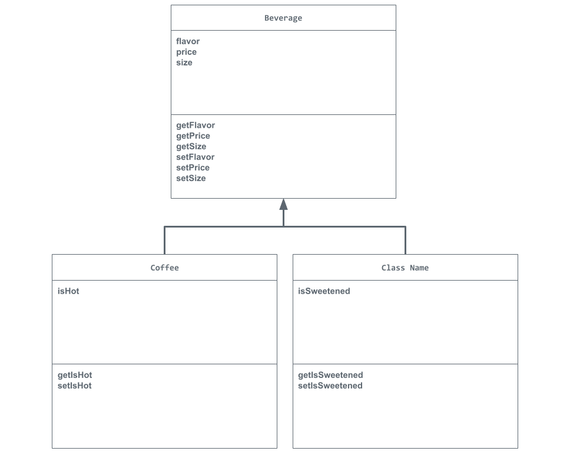

# Unit 2 - Store Management Project

## Introduction

You are opening a new business in your community! Businesses often need programs to manage the products and services they offer and track orders and requests from customers. Your goal is to create a store management system for your business.

## Requirements

Use your knowledge of object-oriented programming and class structure and design to create your store management system:
- **Create a class hierarchy** – Develop a superclass that represents a product or service your business offers and one or more subclasses that extend the superclass to represent more specific types of products or services.
- **Declare instance variables** – Declare instance variables in the superclass that are shared with the subclasses and instance variables in the subclasses that are not shared with the superclass.
- **Write constructors** – Write no-argument and parameterized constructors in the superclass and subclasses. Subclass constructors use the super keyword to call the superclass constructor.
- **Implement accessor and mutator methods** – Write accessor and mutator methods for instance variables that should be accessible and/or modifiable from outside of the class.
- **Implement a toString() method** – Write toString() methods in the superclass and subclasses that return information about the state of an object.

## UML Diagram

Embed your UML Diagram here. Upload the image of your UML Diagram to your repo, then use Markdown to insert your image here:

## Description

1. Write a description of your project here. Include what your store you made, and why you chose this topic. In your description, include as many vocab words from our class to explain how you represented the item/service from your store. If you have user input, explain how the user will interact with your store such as which questions are prompted to the user, what response is your program expecting, and how that is used to output information for your store in the console.

In my project, I created three different classes: Beverage, Coffee, and Tea. The Beverage class is the superclass that contains the shared attributes of flavor, price, and size. The Coffee and Tea subclasses uses inheritance to get the attributes from the superclass. The Coffee class also has an isHot attribute, while the Tea class has an isSweetened attribute.

I used instance variables to store each beverage's information and constructors to initialize the attributes when objects are created. I also used overloaded constructors to allow beverages to be created with default values or with specific information. Accessor methods allow the program to retrieve information, while mutator methods allow attributes to be changed. My setPrice() method also uses an if-else statement to prevent the price from being negative.

Another important concept I used is method overriding. Both the Coffee and Tea classes override the toString() method to display the beverage's information along with its additional attribute. I also used the super keyword to call the superclass constructor and reuse the superclass's toString() method.

When the program runs, the store can display information about different beverage objects in the console, including their flavor, price, size, and whether the coffee is hot or the tea is sweetened. 

2. How is this project related to STEAM (Science, Technology, Engineering, Art, and Mathematics)? Provide explicit examples from the project and details as possible. 

This project is related to STEAM since technology was the biggest part of my project as I used Java to create a virtual beverage store. It is also related to math since my program works and stores double data type. I also used an if-else statement in the setPrice() method to check if the price was negative. If the price was less than zero, then the value would be set to zero, otherwise, the program would set the price to the new price. This demonstrates my use of logical thinking and comparisons.

3. What SLOs did you demonstrate during completing this project?

Some SLOs that I demonstrated during this project is being a critical thinker since I had to use some logic to think about how this code should work.

